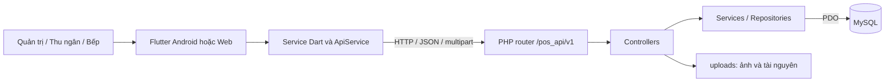

# Savor POS — Hệ thống quản lý bán hàng nhà hàng

**Savor POS** là dự án quản lý hoạt động bán hàng tại nhà hàng, xây dựng bằng **Flutter, PHP và MySQL**. Hệ thống tổ chức quy trình từ chọn bàn, gọi món và topping đến theo dõi chế biến, thanh toán, xem hóa đơn và quản trị dữ liệu.

Ứng dụng có giao diện tiếng Việt, định dạng tiền Việt Nam và ba vai trò chính: **quản trị viên**, **thu ngân**, **nhân viên bếp**.

| Thông tin | Giá trị trong mã nguồn |
|---|---|
| Tên sản phẩm | Savor POS |
| Package Flutter | `pos_flutter_pka` |
| Phiên bản khai báo | `1.0.0+1` |
| Dart SDK | `>=3.4.0 <4.0.0` |
| Giao diện | Flutter, Material 3 |
| Backend | PHP thuần, HTTP API `/v1` |
| Database | MySQL 8+, InnoDB, `utf8mb4` |
| Nền tảng có thư mục cấu hình | Android, Web |
| Locale chính | `vi_VN` |
| Múi giờ backend | `Asia/Bangkok` |

> Tài liệu được đối chiếu với mã nguồn ngày 28/10/2026. README mô tả cấu trúc và hành vi thể hiện trong repository, không xác nhận đã kiểm thử đầu cuối hoặc đủ điều kiện vận hành công khai. Các phần còn hạn chế được ghi riêng bên dưới.

## Mục lục

- [1. Mục tiêu và phạm vi](#1-mục-tiêu-và-phạm-vi)
- [2. Chức năng và vai trò](#2-chức-năng-và-vai-trò)
- [3. Kiến trúc hệ thống](#3-kiến-trúc-hệ-thống)
- [4. Công nghệ và thư viện](#4-công-nghệ-và-thư-viện)
- [5. Cấu trúc thư mục](#5-cấu-trúc-thư-mục)
- [6. Yêu cầu môi trường](#6-yêu-cầu-môi-trường)
- [7. Cài đặt và chạy dự án](#7-cài-đặt-và-chạy-dự-án)
- [8. Hướng dẫn sử dụng](#8-hướng-dẫn-sử-dụng)
- [9. Sơ đồ bàn nhà hàng](#9-sơ-đồ-bàn-nhà-hàng)
- [10. Cơ sở dữ liệu](#10-cơ-sở-dữ-liệu)
- [11. Tổng quan API](#11-tổng-quan-api)
- [12. Kiểm tra và kiểm thử](#12-kiểm-tra-và-kiểm-thử)
- [13. Build và triển khai](#13-build-và-triển-khai)
- [14. Xử lý lỗi thường gặp](#14-xử-lý-lỗi-thường-gặp)
- [15. Giới hạn hiện tại](#15-giới-hạn-hiện-tại)
- [16. Bảo trì và phát triển tiếp](#16-bảo-trì-và-phát-triển-tiếp)
- [17. Đóng góp và giấy phép](#17-đóng-góp-và-giấy-phép)

## 1. Mục tiêu và phạm vi

Savor POS tập trung vào luồng phục vụ tại bàn và phối hợp giữa quầy thu ngân với bếp:

1. Quản trị viên thiết lập thực đơn, topping, khu vực, bàn và tài khoản.
2. Thu ngân chọn bàn, mở đơn và thêm món theo yêu cầu của khách.
3. Bếp theo dõi món cần chế biến và cập nhật tiến độ.
4. Thu ngân rà soát đơn, áp dụng giảm giá nếu có, thanh toán và in phiếu qua PDF.
5. Quản trị viên tra cứu hóa đơn và theo dõi tổng hợp bán hàng.

Repository còn có API cho nguyên liệu, định lượng, kho và ca thu ngân. Sự tồn tại của API không đồng nghĩa mọi nghiệp vụ đã có màn hình Flutter hoàn chỉnh.

## 2. Chức năng và vai trò

### 2.1. Các vai trò đăng nhập

| Vai trò | Mã database | Màn hình chính | Phạm vi sử dụng |
|---|---|---|---|
| Quản trị viên | `admin` | `HomeAdminScreen` | Quản lý thực đơn, khu vực, bàn, topping, nhân sự, khuyến mãi, hóa đơn và báo cáo |
| Thu ngân | `cashier` | `HomeCashierScreen` | Chọn bàn, tạo đơn, gọi món, theo dõi đơn và thanh toán |
| Nhân viên bếp | `kitchen` | `HomeKitchenScreen` | Xem hàng đợi, theo dõi và cập nhật trạng thái món |

Ứng dụng chọn màn hình theo vai trò sau đăng nhập. Backend kiểm tra đăng nhập và vai trò tại từng controller; quyền thực tế của endpoint cần đối chiếu controller tương ứng.

### 2.2. Các nhóm chức năng

| Nhóm | Chức năng thể hiện trong mã nguồn |
|---|---|
| Xác thực | Đăng nhập; lưu phiên bằng `shared_preferences`; xử lý phản hồi không còn quyền xác thực |
| Khu vực và bàn | Quản lý khu vực, mã bàn, sức chứa, trạng thái; hiển thị thường hoặc sơ đồ |
| Thực đơn | Quản lý danh mục, tên món, giá, mô tả, SKU, thuế suất, trạng thái bán và ảnh |
| Topping | Quản lý nhóm, tùy chọn và gắn nhóm lựa chọn vào món |
| Đơn hàng | Tạo đơn theo bàn; thêm món, số lượng, topping, ghi chú; xem chi tiết và hủy |
| Bếp | Hàng đợi, lịch sử, cập nhật trạng thái; tự tải lại theo chu kỳ 30 giây khi bật |
| Giảm giá | Giảm theo phần trăm hoặc số tiền; mã, thời gian áp dụng, ngưỡng đơn tối thiểu |
| Thanh toán | API checkout, phương thức thanh toán, giao dịch và hóa đơn |
| In phiếu | Tạo PDF và gọi luồng in qua `pdf`, `printing` |
| Báo cáo | Màn hình tổng hợp từ hóa đơn theo thời gian; backend có API báo cáo riêng |
| Nhân sự | Quản lý tài khoản, vai trò và trạng thái hoạt động |
| API mở rộng | Nguyên liệu, định lượng, kho, ca thu ngân, nhật ký, xuất/nhập thực đơn, kiểm tra hệ thống |

**Tình trạng cần lưu ý:** màn hình nhật ký hiện dùng dữ liệu mẫu; nút kiểm tra kết nối gọi route chưa có; màn hình báo cáo chỉ lấy một trang hóa đơn với `pageSize: 200`. Xem [giới hạn hiện tại](#15-giới-hạn-hiện-tại).

## 3. Kiến trúc hệ thống



### Frontend Flutter

- `lib/main.dart`: khởi tạo Flutter, locale, phiên đã lưu, theme và màn hình theo vai trò.
- `lib/screens/`: màn hình nghiệp vụ.
- `lib/widgets/`: thành phần giao diện dùng lại và sơ đồ bàn.
- `lib/models/`: ánh xạ dữ liệu JSON thành đối tượng Dart.
- `lib/services/`: gom thao tác gọi API theo nghiệp vụ.
- `lib/services/api_service.dart`: dựng URL, gắn header xác thực, gửi request và xử lý phản hồi.
- `lib/config.dart`: địa chỉ backend và tiền tố phiên bản API.

Luồng dữ liệu chính: `Screen → Service → ApiService → Backend`. Dù `mysql1` có trong dependencies, ứng dụng chủ yếu giao tiếp với backend qua HTTP API.

### Backend PHP

- Entry point đúng: `backend/pos_api/index.php`.
- Router phân phối request theo đường dẫn và HTTP method.
- Controller kiểm tra đầu vào, xác thực/phân quyền và trả JSON.
- Repository thực hiện truy vấn bằng PDO.
- Service xử lý các nghiệp vụ như đơn hàng và media.
- `lib/` cung cấp kết nối database, xác thực, HTTP và tiện ích.
- Ảnh upload được lưu dưới `backend/pos_api/uploads/`.

Backend là PHP thuần; repository không cung cấp quy trình cài đặt bằng Composer hoặc framework Laravel.

## 4. Công nghệ và thư viện

Các phiên bản dưới đây là ràng buộc trong `pubspec.yaml`. Phiên bản đã giải quyết được lưu trong `pubspec.lock`.

| Thành phần | Phiên bản khai báo | Mục đích |
|---|---|---|
| Flutter / Material | Theo Flutter SDK | Giao diện ứng dụng |
| `http` | `^1.2.1` | HTTP request |
| `shared_preferences` | `^2.2.2` | Phiên và tùy chọn cục bộ |
| `intl` | `^0.19.0` | Định dạng ngày, giờ, tiền |
| `image_picker` | `^1.1.2` | Chọn ảnh |
| `pdf`, `printing` | `^3.10.6`, `^5.12.0` | Tạo và in PDF |
| `wakelock_plus` | `^1.1.4` | Khả năng giữ màn hình hoạt động |
| `flutter_riverpod`, `riverpod` | `^2.5.1` | Thư viện quản lý trạng thái được khai báo |
| `image`, `archive` | `4.9.2`, `4.0.9` | Tiện ích ảnh và lưu trữ được khai báo |
| `path`, `path_provider` | `^1.9.0`, `^2.1.4` | Đường dẫn và thư mục |
| `mysql1` | `^0.20.0` | Thư viện MySQL được khai báo; luồng chính đi qua API |
| `flutter_test`, `flutter_lints` | SDK / `^5.0.0` | Kiểm thử và phân tích mã |

## 5. Cấu trúc thư mục

```text
.
├── README.md
├── pubspec.yaml                 # Metadata, dependencies, assets
├── pubspec.lock                 # Phiên bản dependencies đã giải quyết
├── analysis_options.yaml        # Quy tắc phân tích Dart
├── lib/
│   ├── main.dart                # Điểm khởi động Flutter
│   ├── config.dart              # URL API
│   ├── models/                  # User, Order, Item, Table, Promotion...
│   ├── screens/                 # Đăng nhập, quản trị, thu ngân, bếp...
│   ├── services/                # API, xác thực, đơn hàng, topping...
│   ├── utils/                   # JSON, điều hướng
│   └── widgets/                 # Thẻ món, bàn, đơn và sơ đồ
├── assets/
│   ├── images/                  # Ảnh giao diện đăng nhập
│   └── maps/                    # Ba ảnh sơ đồ và table_links.json
├── backend/
│   ├── index.php                # Entry point cũ; không dùng triển khai
│   └── pos_api/
│       ├── index.php            # Router API chính
│       ├── config.php           # Database, CORS, thư mục upload
│       ├── .htaccess            # Apache rewrite
│       ├── query.sql            # Schema backend hiện tại
│       ├── ping.php             # Kiểm tra PHP phản hồi
│       ├── controllers/
│       ├── repos/
│       ├── services/
│       ├── lib/
│       ├── tools/               # Công cụ thay bộ bàn theo sơ đồ
│       └── uploads/             # Ảnh được backend phục vụ
├── database/
│   └── replace_tables_from_maps.sql
├── docs/
│   ├── DEPLOYMENT_VI.md         # Hướng dẫn triển khai chi tiết
│   ├── schema.sql              # Schema cũ
│   └── seed.sql                # Dữ liệu mẫu của mô hình cũ
├── restaurant-maps/             # Ảnh thiết kế sơ đồ
├── test/                       # Kiểm thử Flutter
├── android/                    # Cấu hình Android
└── web/                        # Cấu hình Web
```

`.dart_tool/`, `build/` và các bản sao lưu cục bộ không phải mã nguồn nghiệp vụ cần chỉnh sửa.

## 6. Yêu cầu môi trường

| Thành phần | Yêu cầu |
|---|---|
| Flutter | SDK có Dart đáp ứng `>=3.4.0 <4.0.0` và giải quyết được dependencies |
| PHP | PHP 8.x; mã sử dụng các hàm PHP 8 |
| PHP extensions | `PDO`, `pdo_mysql`; đối chiếu thêm yêu cầu xử lý ảnh/upload theo môi trường |
| Database | MySQL 8+ theo mục tiêu schema |
| Web server | Apache có `mod_rewrite`, cho phép `.htaccess` |
| Android | Android SDK, emulator hoặc điện thoại; Android Studio thuận tiện cho thiết lập |
| Web | Chrome để phát triển, CORS phù hợp |
| Tùy chọn | Laragon để chạy Apache/PHP/MySQL trên Windows |

Repository chưa có cấu hình iOS, Windows desktop, macOS hoặc Linux desktop. Không mặc định các nền tảng này đã được hỗ trợ.

## 7. Cài đặt và chạy dự án

Các bước dưới đây dành cho môi trường phát triển. Ví dụ dùng Laragon trên Windows; thay đường dẫn theo máy thực tế. Xem thêm [hướng dẫn triển khai](docs/DEPLOYMENT_VI.md).

### Bước 1 — Kiểm tra công cụ

Mở terminal tại thư mục chứa `pubspec.yaml`:

```powershell
flutter --version
flutter doctor -v
php -v
php -m
flutter pub get
```

Nếu phát triển Android và thiếu chấp thuận license:

```powershell
flutter doctor --android-licenses
```

### Bước 2 — Chuẩn bị backend

1. Khởi động Apache và MySQL.
2. Nếu đã có bản triển khai/database, sao lưu database, backend, cấu hình và `uploads` trước khi đồng bộ.
3. Đưa **nội dung** `backend/pos_api/` vào thư mục web, ví dụ `C:\laragon\www\pos_api`.
4. Thư mục đích phải chứa trực tiếp `index.php`, `config.php`, `.htaccess`, `controllers/`, `repos/`, `services/`, `lib/`, `uploads/`.
5. Bật `mod_rewrite`, cho phép `.htaccess`, giữ đường dẫn `/pos_api/` cho cấu hình hiện tại.
6. Cấp quyền ghi `uploads` cho tài khoản chạy PHP.

**Không dùng `backend/index.php` ở cấp ngoài:** các đường dẫn include không khớp cấu trúc backend hiện tại.

### Bước 3 — Cấu hình MySQL

Sửa `config.php` trong bản backend đang được web server phục vụ:

```php
define('DB_DSN', 'mysql:host=localhost;port=3306;dbname=pos;charset=utf8mb4');
define('DB_USER', 'TEN_USER_MYSQL');
define('DB_PASS', 'MAT_KHAU_MYSQL');
```

Repository mặc định database `pos`, user `root`, mật khẩu trống. Thay bằng cấu hình thực tế. Tài khoản MySQL khác tài khoản đăng nhập POS.

Dự án dùng hằng số trong PHP và Dart; chưa có cơ chế nạp `.env` hoặc `--dart-define` cho các cấu hình này.

### Bước 4 — Khởi tạo database mới

Import [backend/pos_api/query.sql](backend/pos_api/query.sql). File tạo/chọn database `pos` và tạo bảng nghiệp vụ.

> Chỉ import trực tiếp trên môi trường mới/rỗng. Các lệnh tạo bảng không được thiết kế để chạy lặp trên database đã có cấu trúc. Với dữ liệu hiện hữu, cần so sánh schema và chuẩn bị migration riêng. `docs/schema.sql` và `docs/seed.sql` thuộc mô hình cũ, không dùng khởi tạo backend hiện tại.

Schema không tạo tài khoản mẫu. Sau khi import, **thay các mật khẩu ví dụ trước khi chạy** SQL tạo tài khoản và phương thức tiền mặt:

```sql
USE pos;

INSERT INTO users (name, username, password_plain, role, is_active)
VALUES
  ('Quản trị', 'admin', 'THAY_MAT_KHAU_ADMIN', 'admin', 1),
  ('Thu ngân', 'cashier', 'THAY_MAT_KHAU_THU_NGAN', 'cashier', 1),
  ('Bếp', 'kitchen', 'THAY_MAT_KHAU_BEP', 'kitchen', 1);

INSERT INTO payment_methods (code, name, enabled)
VALUES ('cash', 'Tiền mặt', 1);
```

Các tài khoản trên là ví dụ bạn tự tạo. Phương thức `cash` cần tồn tại cho luồng checkout mặc định.

Backend hiện so sánh trực tiếp với `password_plain`. Chuyển sang hash phải sửa đồng bộ logic backend; chỉ ghi hash vào cột hiện tại sẽ làm đăng nhập không khớp.

### Bước 5 — Kiểm tra backend

Mở `http://localhost/pos_api/ping.php`. JSON có `ok: true` chỉ xác nhận PHP phản hồi, chưa kiểm tra MySQL.

Kiểm tra đăng nhập và endpoint có xác thực bằng PowerShell:

```powershell
$posCredential = Get-Credential -UserName admin -Message 'Nhap tai khoan POS'
$posBody = @{
  username = $posCredential.UserName
  password = $posCredential.GetNetworkCredential().Password
} | ConvertTo-Json

$posSession = Invoke-RestMethod -Method Post `
  -Uri 'http://localhost/pos_api/v1/auth/login' `
  -ContentType 'application/json' -Body $posBody

$posSession.ok
$posHeaders = @{ Authorization = "Bearer $($posSession.data.token)" }
Invoke-RestMethod -Uri 'http://localhost/pos_api/v1/categories' -Headers $posHeaders
```

Danh mục có thể rỗng trên database mới. Không chia sẻ token hoặc toàn bộ đối tượng phiên.

### Bước 6 — Chọn URL API

Sửa [lib/config.dart](lib/config.dart):

```dart
const String apiBase = 'http://10.0.2.2/pos_api';
const String apiVersionPath = '/v1';
```

| Nơi chạy ứng dụng | `apiBase` |
|---|---|
| Android Studio emulator tiêu chuẩn | `http://10.0.2.2/pos_api` |
| Chrome trên máy chạy backend | `http://localhost/pos_api` |
| Android thật hoặc máy khác cùng LAN | `http://IP_MAY_CHU/pos_api` |

Nếu Apache dùng cổng khác, thêm cổng, ví dụ `http://192.168.1.20:8080/pos_api`. IP này chỉ minh họa.

- Không thêm `/v1` vào `apiBase` vì đã có `apiVersionPath`.
- Trên điện thoại thật, `localhost` là chính điện thoại; dùng IP máy chủ.
- Khởi động lại hoặc build lại ứng dụng sau khi đổi cấu hình.
- Đổi thư mục `/pos_api` cần rà soát `.htaccess` và logic URL media của backend.

### Bước 7 — Chạy Android

```powershell
flutter devices
flutter run -d ID_THIET_BI
```

Thay `ID_THIET_BI` bằng ID từ `flutter devices`.

Nếu debug bị chặn HTTP do chính sách cleartext, cấu hình bên trong `manifest` của `android/app/src/debug/AndroidManifest.xml`:

```xml
<application android:usesCleartextTraffic="true" />
```

Với điện thoại thật, mở `http://IP_MAY_CHU/pos_api/ping.php` trên điện thoại trước. Hai thiết bị cần cùng mạng; Apache phải nhận kết nối LAN và Firewall cho phép đúng cổng. Điện thoại chỉ truy cập API, không cần mở cổng MySQL ra LAN.

### Bước 8 — Chạy Web

Đặt `apiBase` phù hợp. Sửa header CORS trong bản `config.php` đang chạy để cho phép header frontend gửi:

```php
header('Access-Control-Allow-Headers: Authorization, Content-Type, X-Auth-Token');
```

Frontend gửi cả `Authorization` và `X-Auth-Token`, trong khi cấu hình mặc định chưa cho phép header thứ hai.

```powershell
flutter run -d chrome
```

Khi triển khai Web thật, cấu hình origin và HTTPS theo môi trường. Trang HTTPS gọi API HTTP có thể bị chặn vì mixed content.

## 8. Hướng dẫn sử dụng

### 8.1. Thiết lập ban đầu

Đăng nhập quản trị và thực hiện theo thứ tự:

1. Tạo danh mục món.
2. Tạo món, gán danh mục, giá, thông tin và ảnh.
3. Tạo nhóm topping, tùy chọn và gắn vào món.
4. Tạo khu vực, bàn, mã bàn và sức chứa.
5. Tạo tài khoản thu ngân, bếp với đúng vai trò.
6. Tạo giảm giá nếu cần.
7. Kiểm tra phương thức thanh toán `cash` trong database.

### 8.2. Luồng phục vụ mẫu

```text
Đăng nhập thu ngân
  → Chọn khu vực / bàn
  → Mở đơn
  → Thêm món, số lượng, topping, ghi chú
  → Bếp nhận món và cập nhật tiến độ
  → Thu ngân rà soát, áp dụng giảm giá, thanh toán
  → Xem hóa đơn / in PDF
```

API thêm món đưa dòng món vào luồng xử lý bếp. Router hiện không cung cấp endpoint “gửi bếp” riêng.

### 8.3. Trạng thái nghiệp vụ

| Đối tượng | Giá trị khai báo trong schema |
|---|---|
| Bàn | `free` — trống; `occupied` — đang dùng; `cleaning` — đang dọn |
| Đơn | `open`, `closed`, `cancelled` |
| Dòng món ở bếp | `queued`, `preparing`, `ready`, `served`, `cancelled` |
| Phiếu bếp | `open`, `ready`, `served`, `cancelled` |

Đây là tập giá trị dữ liệu; chuyển trạng thái được phép phụ thuộc kiểm tra trong controller/service.

### 8.4. Theo dõi và in phiếu

- Dùng thiết bị hoặc phiên trình duyệt khác đăng nhập bếp khi thử luồng nhiều vai trò.
- Hàng đợi tự tải lại theo chu kỳ 30 giây khi bật; có thể làm mới thủ công.
- Sau thanh toán, kiểm tra dữ liệu đơn, bàn, giao dịch và hóa đơn.
- Chức năng PDF dùng luồng in của nền tảng; chưa có căn cứ xác nhận tích hợp trực tiếp mọi máy in nhiệt, Bluetooth hoặc ESC/POS.

## 9. Sơ đồ bàn nhà hàng

Ứng dụng có chế độ **Thường** và **Sơ đồ**. Tọa độ tương tác được định nghĩa trong `lib/widgets/restaurant_map_view.dart` theo tỷ lệ chuẩn hóa của ảnh.

| Sơ đồ | Tài nguyên | Mã vị trí | Số lượng |
|---|---|---|---|
| 1 — Bistro / khu bàn ăn | `assets/maps/map1.png` | `B01`–`B09` | 9 |
| 2 — Phòng bao | `assets/maps/map2.png` | `P01`, `A01`–`A10` | 11 |
| 3 — Sân vườn | `assets/maps/map3.png` | `S01`–`S10` | 10 |

Tổng cộng **30 vị trí**. `assets/maps/table_links.json` ánh xạ khóa dạng `chỉ_số_sơ_đồ:mã_vị_trí` sang ID bàn, ví dụ `0:B01`.

Khi tạo database mới hoặc thay bộ bàn, ID có thể khác file đi kèm. Cần kiểm tra liên kết thực tế, không mặc định ID có sẵn trong assets luôn tồn tại.

Hai tài nguyên hỗ trợ thay bộ bàn:

- `database/replace_tables_from_maps.sql`.
- `backend/pos_api/tools/replace_map_tables.php`.

Đây là công cụ thay đổi dữ liệu khu vực/bàn, không phải bước bắt buộc để chạy app. Đọc mã, sao lưu và kiểm tra đơn mở trước khi dùng. Không chạy cả hai hoặc chạy lặp như bước seed thông thường; công cụ PHP yêu cầu CLI và cờ `--apply`.

## 10. Cơ sở dữ liệu

Schema chính: [backend/pos_api/query.sql](backend/pos_api/query.sql).

| Nhóm | Bảng |
|---|---|
| Người dùng và nhật ký | `users`, `reason_codes`, `audit_logs`, `activity_logs` |
| Không gian phục vụ | `areas`, `dining_tables` |
| Thực đơn | `kitchen_stations`, `categories`, `items` |
| Topping | `modifier_groups`, `modifier_options`, `item_modifier_groups` |
| Đơn hàng | `orders`, `order_items`, `order_item_modifiers` |
| Phiếu bếp | `kitchen_tickets`, `kitchen_ticket_items` |
| Khuyến mãi | `discounts`, `order_discounts` |
| Thanh toán và ca | `payment_methods`, `payments`, `shifts`, `cash_movements` |
| Hủy đơn/món | `order_cancellations`, `order_item_voids` |
| Kho | `ingredients`, `item_recipes`, `stock_moves` |
| Hóa đơn | `receipts`, `receipt_items` |
| Media | `media_files`, `entity_media` |

Quan hệ nghiệp vụ chính:

- Khu vực có nhiều bàn; đơn hàng có thể tham chiếu bàn.
- Danh mục có nhiều món; món liên kết nhóm topping qua bảng trung gian.
- Đơn có nhiều dòng món; dòng món có các topping đã chọn.
- Giao dịch thanh toán và giảm giá liên kết với đơn.
- Hóa đơn và dòng hóa đơn phục vụ tra cứu sau thanh toán.
- Định lượng liên kết món với nguyên liệu; biến động kho nằm trong `stock_moves`.
- `entity_media` liên kết ảnh với các loại thực thể schema hỗ trợ.

Không dùng schema cũ trong `docs/` để suy luận cột của backend hiện tại. Repository chưa cung cấp quy trình migration có phiên bản để nâng cấp database đang vận hành.

## 11. Tổng quan API

### 11.1. Quy ước

- Base URL phát triển trên máy chủ: `http://localhost/pos_api/v1`.
- Request thông thường: JSON, `Content-Type: application/json`.
- Xác thực: `Authorization: Bearer <token>`; backend có thêm cơ chế đọc header/token dự phòng.
- Upload: multipart, frontend dùng trường `file`.
- Quyền thực tế và validation được kiểm tra trong controller.

Phản hồi thành công theo helper HTTP:

```json
{ "ok": true, "data": {} }
```

Phản hồi lỗi theo helper HTTP:

```json
{
  "ok": false,
  "error": "VALIDATION_FAILED",
  "message": "Missing field: username",
  "details": { "field": "username" }
}
```

`data` có thể là object hoặc array. Một số phản hồi trực tiếp từ router có thể không có `details`.

### 11.2. Endpoint chính

Đường dẫn dưới đây được ghép sau `/v1`; `{id}` là ID thực tế.

| Nhóm | Method và đường dẫn | Chức năng |
|---|---|---|
| Xác thực | `POST /auth/login` | Đăng nhập |
| Danh mục | `GET, POST /categories`; `PUT, DELETE /categories/{id}` | Danh sách, tạo, sửa, xóa |
| Món | `GET, POST /items`; `GET, PUT, DELETE /items/{id}` | Quản lý món |
| Topping của món | `GET /items/{id}/modifiers` | Lựa chọn topping |
| Khu vực | `GET, POST /areas`; `PUT, DELETE /areas/{id}` | Quản lý khu vực |
| Bàn | `GET, POST /tables`; `PUT, DELETE /tables/{id}`; `PUT /tables/{id}/status` | Bàn và trạng thái |
| Đơn | `GET, POST /orders`; `GET /orders/{id}` | Danh sách, tạo, chi tiết |
| Dòng món | `POST /orders/{id}/items`; `PUT, DELETE /order-items/{id}` | Thêm, sửa, xóa |
| Kết thúc đơn | `POST /orders/{id}/checkout`; `POST /orders/{id}/cancel` | Thanh toán/hủy |
| Bếp | `GET /kitchen/queue`; `GET /kitchen/history`; `PUT /kitchen/items/{id}/status` | Hàng đợi, lịch sử, tiến độ |
| Hóa đơn | `GET /admin/receipts`; `GET /admin/receipts/{id}` | Tra cứu |
| Người dùng | `GET, POST /admin/users`; `PUT, DELETE /admin/users/{id}` | Quản lý tài khoản |
| Giảm giá tại quầy | `GET /cashier/discounts` | Chương trình khả dụng |
| Giảm giá quản trị | `GET, POST /admin/discounts`; `PUT, DELETE /admin/discounts/{id}`; `GET /admin/discounts/history` | Quản lý và lịch sử |
| Upload | `POST /uploads/items`, `/uploads/categories`, `/uploads/areas`, `/uploads/modifiers`, `/uploads/stations` | Tải ảnh |

### 11.3. API quản trị mở rộng

| Nhóm | Đường dẫn tiêu biểu | Phạm vi |
|---|---|---|
| Topping | `/admin/modifier-groups`, `/admin/modifier-groups/{id}/options`, `/admin/modifier-options/{id}` | Nhóm và lựa chọn |
| Gắn topping | `/admin/items/{id}/modifier-groups` | Liên kết với món |
| Mã lý do | `/admin/reason-codes` | Lý do nghiệp vụ |
| Trạm bếp | `/admin/stations`, `/admin/stations/{id}/icon` | Trạm và biểu tượng |
| Nguyên liệu | `/admin/ingredients` | Danh mục nguyên liệu |
| Định lượng | `/admin/items/{id}/recipe` | Công thức món |
| Kho | `/admin/stock-moves`, `/admin/stock-in`, `/admin/stock-adjust`, `/admin/stock-summary`, `/admin/stock-consumption` | Biến động và tổng hợp |
| Thanh toán | `/admin/payment-methods`, `/admin/orders/{id}/payments` | Phương thức và giao dịch |
| Ca | `/admin/shifts`, `/admin/shifts/{id}/close`, `/admin/shifts/{id}/movements`, `/admin/shifts/{id}/summary` | Ca và thu/chi |
| Báo cáo | `/admin/reports/revenue`, `/admin/reports/top-items`, `/admin/reports/inventory`, `/admin/reports/shifts` | Tổng hợp |
| Nhật ký | `/admin/logs/audit`, `/admin/logs/activity` | Dữ liệu nhật ký backend |
| Công cụ | `/admin/tools/export-menu`, `/admin/tools/import-menu`, `/admin/tools/system-check` | Xuất/nhập, kiểm tra |

Đây là bản đồ route, không phải đặc tả đầy đủ payload. Xem `backend/pos_api/index.php` để biết HTTP method, controller và điều kiện xử lý.

### 11.4. Payload minh họa

Đăng nhập:

```json
{ "username": "admin", "password": "MAT_KHAU_BAN_DA_TAO" }
```

Tạo đơn:

```json
{ "table_id": 1, "customer_name": "Khách thử nghiệm" }
```

Thêm món:

```json
{ "item_id": 1, "qty": 2, "modifiers": [], "note": "Ít cay" }
```

ID chỉ minh họa, phải thay bằng dữ liệu thật. Payload checkout và giảm giá cần đối chiếu `OrdersController.php`, `OrdersService.php`, `lib/services/order_service.dart`.

## 12. Kiểm tra và kiểm thử

### 12.1. Lệnh Flutter

```powershell
flutter analyze
flutter test test/restaurant_map_test.dart
flutter test
```

Đây là hướng dẫn chạy, không phải kết quả đã kiểm thử trong lần viết tài liệu này.

- `test/restaurant_map_test.dart`: kiểm tra số lượng 9/11/10 vị trí, mã duy nhất trong từng sơ đồ, tọa độ trong ảnh và chuyển chế độ hiển thị.
- `test/widget_test.dart`: test cũ import `package:pos_flutter_pka/app.dart` không tồn tại; điểm khởi động hiện tại là `lib/main.dart`.
- Vì vậy không kỳ vọng toàn bộ test hoặc phân tích dự án sạch lỗi trước khi cập nhật test cũ. Sửa import đơn thuần chưa đủ nếu kỳ vọng giao diện đã thay đổi.

### 12.2. Kiểm tra thủ công

- [ ] Ping và đăng nhập API thành công.
- [ ] Ba vai trò vào đúng màn hình.
- [ ] Tạo danh mục, món, ảnh và topping.
- [ ] Tạo khu vực, bàn và kiểm tra liên kết sơ đồ.
- [ ] Tạo đơn, thêm món, topping, ghi chú.
- [ ] Bếp nhận dữ liệu và cập nhật tiến độ.
- [ ] Thu ngân thấy thay đổi sau khi làm mới.
- [ ] Giảm giá và tổng tiền được kiểm tra phía server.
- [ ] Thanh toán tạo đúng giao dịch/hóa đơn, thử cả thao tác lặp.
- [ ] Trạng thái bàn/đơn đúng sau thanh toán hoặc hủy.
- [ ] In PDF trên thiết bị đích.
- [ ] Đối chiếu báo cáo với SQL và tập hóa đơn đầy đủ.
- [ ] Kiểm tra endpoint quản trị bằng tài khoản không đủ quyền.

## 13. Build và triển khai

### 13.1. Android APK

Kiểm tra `android/app/src/main/AndroidManifest.xml`. Quyền mạng hiện có ở debug/profile; cần thêm vào manifest main cho release:

```xml
<uses-permission android:name="android.permission.INTERNET" />
```

Đặt quyền là con trực tiếp của `manifest`. Nếu APK nội bộ dùng HTTP, chính sách cleartext phải được cấu hình cho biến thể tương ứng; cấu hình debug không tự áp dụng cho release.

```powershell
flutter build apk --release
```

Đầu ra thông thường: `build/app/outputs/flutter-apk/app-release.apk`.

`android/app/build.gradle.kts` hiện dùng `com.example.pos_flutter_pka` và ký release bằng debug key. Cần định danh và khóa ký riêng trước khi phát hành chính thức.

### 13.2. Web

Đặt URL API theo người truy cập rồi chạy:

```powershell
flutter build web --release
```

Đầu ra: `build/web/`. Triển khai nội dung thư mục này lên web server; PHP và uploads được phục vụ riêng. Nếu đặt Web trong thư mục con, cấu hình `base href` phù hợp.

### 13.3. Sao lưu

Cần bảo quản database gồm cấu trúc/dữ liệu, toàn bộ `uploads`, cấu hình triển khai, các ánh xạ bàn tùy chỉnh và khóa ký Android khi có. Database và ảnh cần nhất quán về thời điểm; thử khôi phục ở môi trường riêng trước khi thay thế hệ thống đang dùng.

## 14. Xử lý lỗi thường gặp

| Hiện tượng | Điểm cần kiểm tra |
|---|---|
| Không mở được ping | Apache, thư mục, IP/cổng, Firewall |
| Ping được nhưng lỗi DB | MySQL, DSN, user/password, `pdo_mysql` của PHP web server |
| `/v1/...` trả 404 | Entry point, `.htaccess`, rewrite, `AllowOverride`, đường dẫn `/pos_api` |
| Thiếu bảng/cột | Schema/database chưa khớp `query.sql` |
| Đăng nhập thất bại | `users`, username, `is_active = 1`, `password_plain` |
| `Invalid payment method: cash` | Thiếu phương thức `cash` hoặc chưa bật |
| Chrome báo CORS | `X-Auth-Token`, origin, OPTIONS |
| Emulator chạy, máy thật lỗi | IP LAN thay cho `10.0.2.2`, Wi-Fi, Apache và Firewall |
| Debug có mạng, release không | INTERNET trong main manifest, HTTPS/cleartext, URL đã build |
| Ảnh không hiển thị | File upload, quyền thư mục, URL media `/pos_api` |
| Sơ đồ liên kết sai bàn | ID trong assets hoặc liên kết đã lưu không khớp database |
| Nút kiểm tra kết nối lỗi | Gọi `/v1/health` chưa có; dùng ping và login để kiểm tra |
| Test thiếu `app.dart` | Test widget cũ chưa theo cấu trúc hiện tại |
| Báo cáo thiếu hóa đơn | Màn hình chỉ lấy một trang yêu cầu 200 bản ghi |
| Web HTTPS không gọi API HTTP | Mixed content; dùng HTTPS đồng bộ |

Để chẩn đoán rewrite, có thể thử cùng request qua `/pos_api/index.php/v1/...` nếu server hỗ trợ PATH_INFO. Sau đó sửa để dùng URL chuẩn; không tự đổi `apiBase` sang `index.php` vì còn ảnh hưởng URL ảnh.

## 15. Giới hạn hiện tại

Các điểm dưới đây cần xử lý hoặc xác minh trước khi vận hành thực tế:

1. **Token đơn giản:** ghép ID, role và thời điểm, không có chữ ký mật mã; parser không kiểm tra thời hạn. Backend tra lại user/role trong database, nhưng cơ chế này chưa bảo đảm chống giả mạo token.
2. **Mật khẩu dạng rõ:** đăng nhập dựa trên `password_plain`; cần đổi đồng bộ sang hash và xác minh mật khẩu.
3. **Log có thể chứa dữ liệu nhạy cảm:** `ApiService` có `debugPrint` body POST/PUT; cần bỏ hoặc che mật khẩu và dữ liệu riêng tư.
4. **CORS chưa đồng bộ:** thiếu `X-Auth-Token`, đang dùng wildcard origin.
5. **Kiểm tra kết nối chưa khớp router:** thiếu `/v1/health`.
6. **Nhật ký giao diện là dữ liệu mẫu:** chưa phản ánh API nhật ký thật.
7. **Báo cáo có giới hạn phân trang:** tổng hợp một trang hóa đơn với `pageSize: 200`, chưa bảo đảm tổng đầy đủ.
8. **Test widget cũ chưa hợp lệ:** import thiếu và kỳ vọng giao diện cũ.
9. **Android release chưa hoàn thiện:** cần rà soát quyền mạng, định danh và khóa ký.
10. **Sơ đồ phụ thuộc dữ liệu:** ID bàn trong assets có thể khác database mới.
11. **API mở rộng cần thử riêng:** kho, ca, báo cáo, import/export và thanh toán chưa được xác nhận đầu cuối qua việc viết README.
12. **Chưa xác nhận offline hoặc đồng bộ thời gian thực:** luồng chính cần API, bếp dùng polling. Không mặc định có WebSocket, cổng thanh toán trực tuyến hoặc hóa đơn điện tử.

Với token và mật khẩu hiện tại, cần hoàn thiện xác thực trước khi mở API ra Internet.

## 16. Bảo trì và phát triển tiếp

Các hướng sau là đề xuất, chưa phải chức năng hoàn thành:

- Token/phiên an toàn có thời hạn, thu hồi; mật khẩu hash.
- Quản lý bí mật ngoài mã nguồn, hạn chế log nhạy cảm.
- Đặc tả OpenAPI và kiểm thử tích hợp backend.
- Cập nhật test Flutter theo luồng đăng nhập/giao diện hiện tại.
- Kiểm thử số tiền, thuế, giảm giá, đồng thời và thanh toán lặp.
- Tổng hợp báo cáo phía server, xử lý phân trang đầy đủ.
- Kết nối nhật ký giao diện tới API thực.
- Migration database có phiên bản và kiểm tra khôi phục backup.
- Tách cấu hình phát triển, thử nghiệm, vận hành.
- Liên kết sơ đồ theo mã bàn ổn định thay vì ID của một database.
- Hoàn thiện màn hình kho/ca nếu đưa vào phạm vi sản phẩm.

## 17. Đóng góp và giấy phép

Khi thay đổi dự án:

1. Mô tả nghiệp vụ và vai trò chịu ảnh hưởng.
2. Đối chiếu model/service Flutter, controller/repository PHP và schema khi đổi dữ liệu.
3. Không commit mật khẩu thật, token, database vận hành hoặc khóa ký.
4. Chạy kiểm tra phù hợp, ghi rõ kết quả và lỗi có sẵn còn tồn tại.
5. Cập nhật tài liệu khi đổi cấu hình, API hoặc cách sử dụng.

Repository hiện chưa có file `LICENSE` xác định giấy phép; các tài liệu đã đối chiếu cũng chưa cung cấp tác giả/liên hệ chính thức. Cần bổ sung trước khi công bố điều khoản sử dụng hoặc phân phối.

Tài liệu liên quan:

- [Hướng dẫn triển khai chi tiết](docs/DEPLOYMENT_VI.md).
- [Metadata và dependencies Flutter](pubspec.yaml).
- [Cấu hình API Flutter](lib/config.dart).
- [Router backend](backend/pos_api/index.php).
- [Schema database hiện tại](backend/pos_api/query.sql).
- [Kiểm thử sơ đồ bàn](test/restaurant_map_test.dart).
